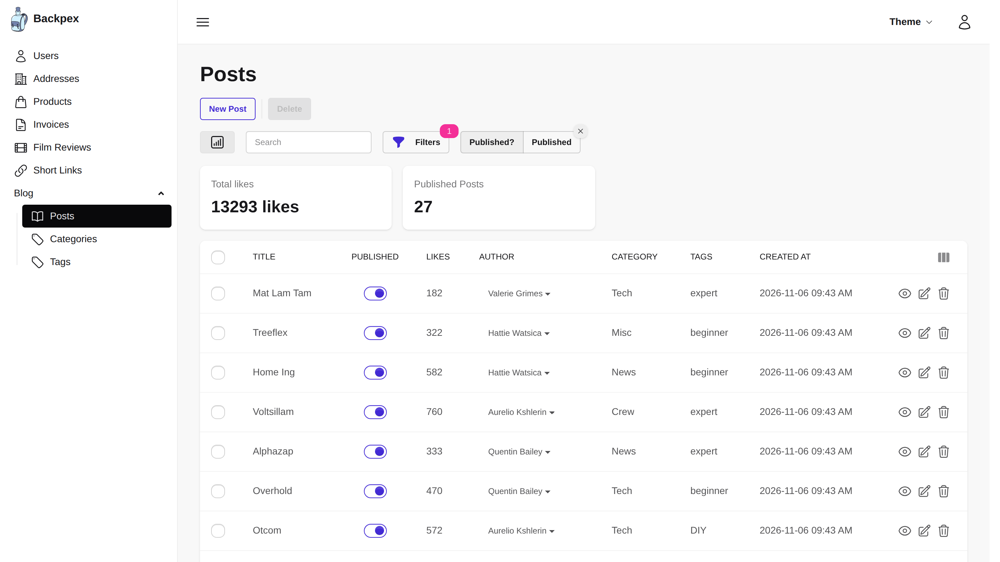

[](https://codecov.io/gh/naymspace/backpex)
[](https://github.com/naymspace/backpex/blob/develop/LICENSE.md)
[](https://hex.pm/packages/backpex)
[](https://hexdocs.pm/backpex)

<div align="center">
  
  <br />
  <br />
  <strong>Admin panels for Phoenix LiveView, built from your Ecto schemas.</strong>
  <br />
  <br />
  <span>🚀 <a href="https://backpex.live/">Live Demo</a></span>
  •
  <span>📚 <a href="https://hexdocs.pm/backpex">Documentation</a></span>
  •
  <span>🛠️ <a href="https://hexdocs.pm/backpex/installation.html">Installation Guide</a></span>
  •
  <span>🩵 <a href="https://hexdocs.pm/backpex/contribute-to-backpex.html">Contribute</a></span>
</div>

# Backpex

Backpex turns your existing Ecto schemas into a complete admin panel: index, show, edit and create views with search, filters, actions, metrics and authorization. Each resource is a single Elixir module, a *LiveResource*, that lives in your Phoenix app, uses your changesets and renders in your layout. Everything runs on LiveView, so there is no separate frontend to build and no second app to deploy.



<div align="center">
  <a href="https://backpex.live/"><strong>Try the Live Demo →</strong></a>
</div>

## Why Backpex?

- **It's your code.** A LiveResource is a plain module in your app. Backpex calls your changesets, your repo and your authorization rules instead of inventing its own.
- **Declarative where it can be, extensible where you need it.** Configure fields, filters and actions as data. When the built-ins don't fit, write your own field, filter or action module against a documented behaviour.
- **Real-time by default.** Built on Phoenix LiveView and PubSub: searches, filters and inline edits update instantly, and changes made by other users show up without a reload.
- **Looks good out of the box.** Styled with Tailwind CSS 4 and daisyUI 5, with a responsive app shell, a theme selector and full-width layouts.

## A LiveResource in 30 Lines

```elixir
defmodule MyAppWeb.PostLive do
  use Backpex.LiveResource,
    adapter_config: [
      schema: MyApp.Blog.Post,
      repo: MyApp.Repo,
      update_changeset: &MyApp.Blog.Post.update_changeset/3,
      create_changeset: &MyApp.Blog.Post.create_changeset/3
    ],
    layout: {MyAppWeb.Layouts, :admin}

  @impl Backpex.LiveResource
  def singular_name, do: "Post"

  @impl Backpex.LiveResource
  def plural_name, do: "Posts"

  @impl Backpex.LiveResource
  def fields do
    [
      title: %{module: Backpex.Fields.Text, label: "Title", searchable: true},
      published: %{module: Backpex.Fields.Boolean, label: "Published", index_editable: true},
      category: %{module: Backpex.Fields.BelongsTo, label: "Category", display_field: :name},
      inserted_at: %{module: Backpex.Fields.DateTime, label: "Created", only: [:index, :show]}
    ]
  end

  @impl Backpex.LiveResource
  def can?(assigns, :delete, _post), do: assigns.current_user.role == :admin
  def can?(_assigns, _action, _post), do: true
end
```

Mount it in your router and you get a searchable, sortable, paginated index with inline editing, plus show, edit and create views:

```elixir
scope "/admin", MyAppWeb do
  pipe_through :browser

  backpex_routes()

  live_session :admin, on_mount: Backpex.InitAssigns do
    live_resources "/posts", PostLive
  end
end
```

## Features

### Resources and fields

- 🧩 **18 built-in field types**: Text, Textarea, Number, Currency, Boolean, Select, MultiSelect, Checkgroup, Date, DateTime, Time, Email, URL and Upload, plus [custom fields](https://hexdocs.pm/backpex/custom-fields.html) for everything else.
- 🔗 **Associations**: BelongsTo, HasMany and HasManyThrough, and InlineCRUD for editing embedded or associated rows inside the parent form.
- ✏️ **Inline editing** of [fields on the index view](https://hexdocs.pm/backpex/index-edit.html), [readonly](https://hexdocs.pm/backpex/readonly.html) and [computed](https://hexdocs.pm/backpex/computed-fields.html) fields, [panels](https://hexdocs.pm/backpex/panels.html) to group fields on forms.
- 🪝 **[Hooks](https://hexdocs.pm/backpex/hooks.html)** before and after an item is created, updated or deleted.

### Finding data

- 🔍 **[Search](https://hexdocs.pm/backpex/basic-search.html)** across fields, or PostgreSQL [full-text search](https://hexdocs.pm/backpex/full-text-search.html) on a generated column.
- 🎛️ **[Filters](https://hexdocs.pm/backpex/what-is-a-filter.html)**: Boolean, Select, MultiSelect and Range, with [presets](https://hexdocs.pm/backpex/filter-presets.html), validated URL params and [custom filters](https://hexdocs.pm/backpex/custom-filter.html).
- 📈 **[Metrics](https://hexdocs.pm/backpex/metrics.html)**: value metrics such as sums or averages above the index table, computed for the current search and filters.
- 🗂️ **Column toggles**: users show and hide columns and metrics on the index view.
- ↕️ **[Ordering](https://hexdocs.pm/backpex/ordering.html)** and **[pagination](https://hexdocs.pm/backpex/pagination.html)** with configurable defaults.

### Actions and access control

- ⚡ **[Item actions](https://hexdocs.pm/backpex/item-actions.html)** for single or selected rows (archive, approve, soft-delete) and **[resource actions](https://hexdocs.pm/backpex/resource-actions.html)** for the whole resource (invite, import, export), both with optional forms and confirmation dialogs.
- 🔒 **[Authorization](https://hexdocs.pm/backpex/live-resource-authorization.html)** in one `can?/3` callback, enforced by Backpex for every view, save, inline edit and action, plus [per-field rules](https://hexdocs.pm/backpex/field-authorization.html). Delegate to the policy library you already use.

### Built for real use

- 💾 **[User preferences](https://hexdocs.pm/backpex/user-preferences.html)**: theme, sidebar state, visible columns and metrics are remembered per user, in the session or in your database.
- 📡 **[Live updates](https://hexdocs.pm/backpex/listen-to-pubsub-events.html)** via PubSub when items are created, updated or deleted.
- 🌍 **[Translations](https://hexdocs.pm/backpex/translations.html)** of every text Backpex renders, with Gettext or your own translator.
- ♿ **Accessible**: components are operable with the keyboard, and every demo resource is audited with axe in CI.
- 🧪 **[Testing helpers](https://hexdocs.pm/backpex/Backpex.Testing.html)** to drive your LiveResources from `Phoenix.LiveViewTest` without depending on Backpex's markup.

## Get Started

Backpex ships with an [Igniter](https://github.com/ash-project/igniter) installer. Install the Igniter archive once, then run the installer in your Phoenix app:

```bash
mix archive.install hex igniter_new
```

```bash
mix igniter.install backpex
```

It configures PubSub, adds the JavaScript hooks, sets up daisyUI and Tailwind, adds the admin routes and creates an admin layout. Review the diff, then follow the [installation guide](https://hexdocs.pm/backpex/installation.html) for the remaining steps and your first LiveResource.

Prefer to set it up by hand? Add Backpex to your dependencies and follow the same guide:

```elixir
def deps do
  [
    {:backpex, "~> 0.23"}
  ]
end
```

### Requirements

- Elixir 1.16 or later
- Phoenix 1.7 or 1.8 and Phoenix LiveView 1.1
- Ecto with a single primary key per schema
- Tailwind CSS 4 and daisyUI 5

Using [Ash](https://ash-hq.org/)? The community project [ash_backpex](https://github.com/enoonan/ash_backpex) connects Backpex to Ash resources.

## Build Backpex Apps with AI Agents

Backpex gives coding agents the context they need to write correct Backpex code:

- **Usage rules** ship with the Hex package in `deps/backpex/usage-rules.md` and always match your installed version. Sync them into your `AGENTS.md` with [usage_rules](https://hexdocs.pm/usage_rules).
- **A Claude Code plugin** with skills to create LiveResources, fields, filters and actions, and to upgrade between Backpex versions:

  ```bash
  /plugin marketplace add naymspace/backpex
  /plugin install backpex@naymspace-backpex
  ```

See [AI Assisted Development](https://hexdocs.pm/backpex/ai-development.html) for details.

## Learn More

- [What is Backpex?](https://hexdocs.pm/backpex/what-is-backpex.html)
- [Why we built Backpex](https://hexdocs.pm/backpex/why-we-built-backpex.html)
- [What is a LiveResource?](https://hexdocs.pm/backpex/what-is-a-live-resource.html)
- [Upgrade guides](https://hexdocs.pm/backpex/v0-23.html) and [changelog](https://github.com/naymspace/backpex/releases)

## Contributing

Bug reports, ideas and pull requests are welcome. Start with [Contribute to Backpex](https://hexdocs.pm/backpex/contribute-to-backpex.html) and the [contributing guide](https://github.com/naymspace/backpex/blob/develop/CONTRIBUTING.md), and have a look at the [open issues](https://github.com/naymspace/backpex/issues).

Backpex is built and maintained by [naymspace](https://naymspace.de).

## License

Backpex is open-source software, licensed under the [MIT License](https://github.com/naymspace/backpex/blob/develop/LICENSE.md).
